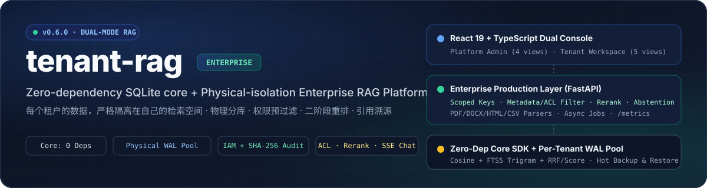
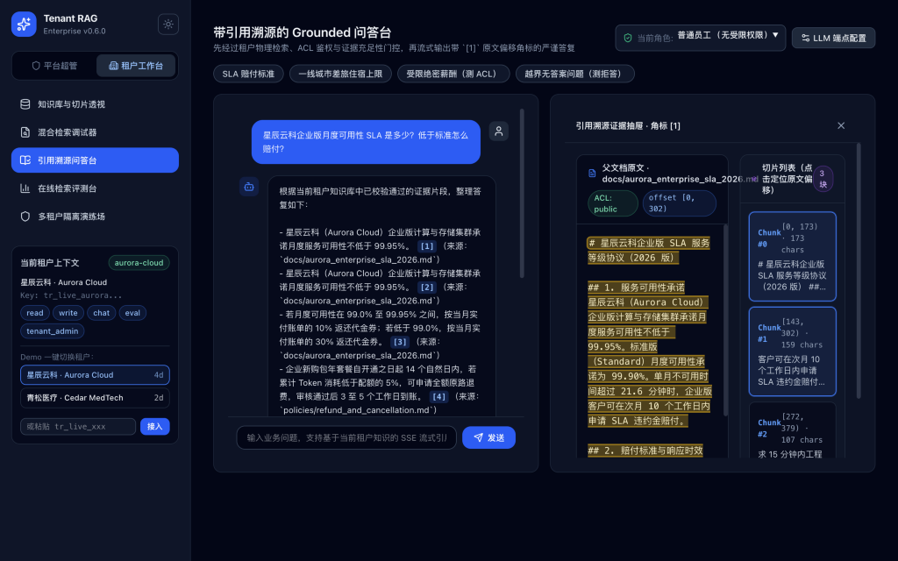
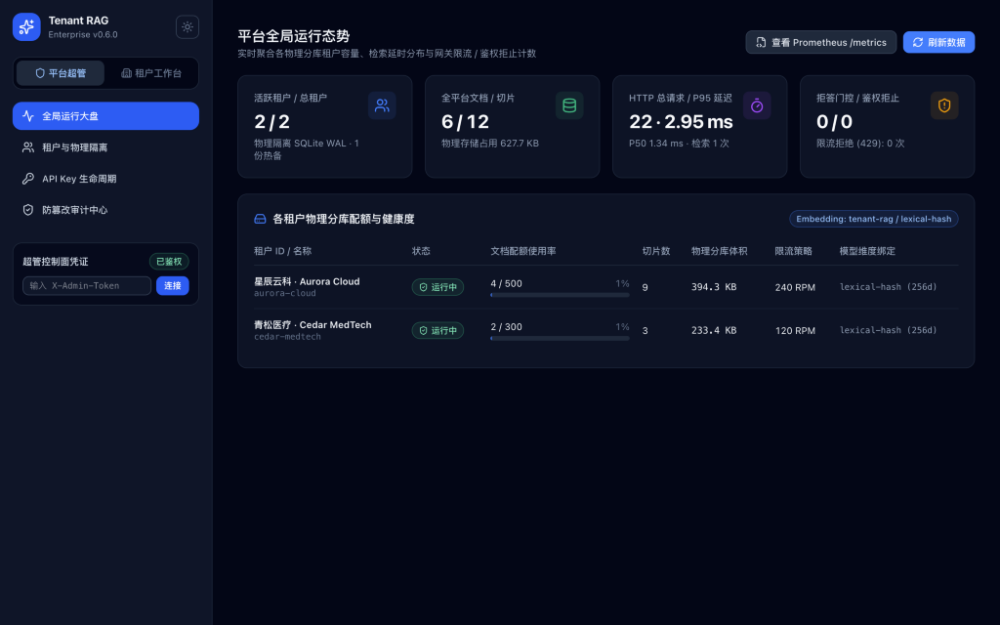
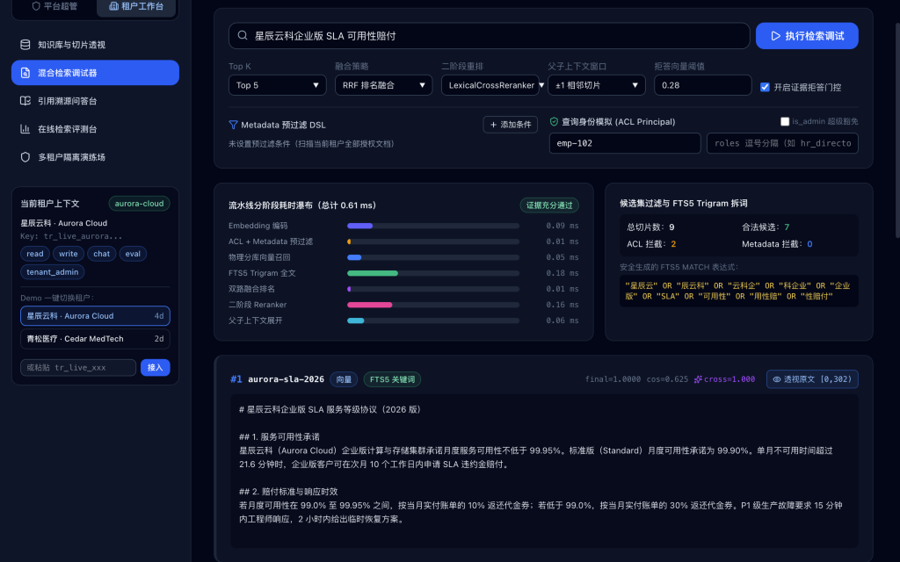
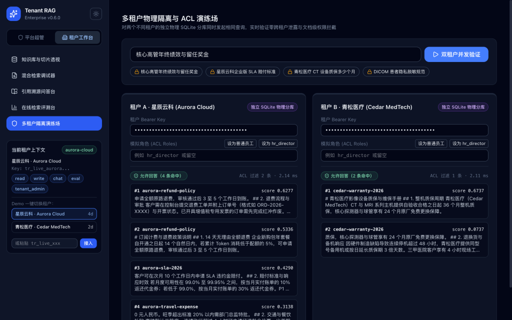
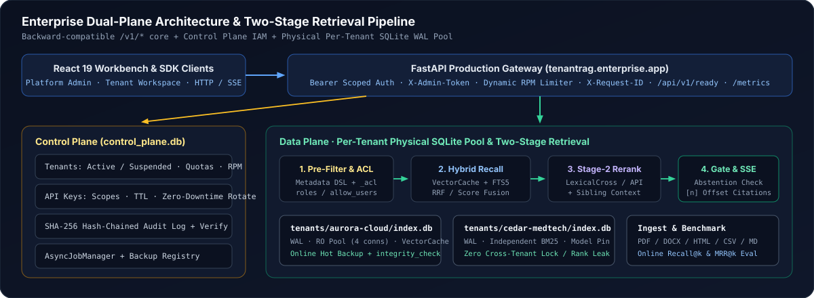

<p align="center">
  
</p>

<p align="center">
  <a href="https://github.com/tsumon/tenant-rag/actions/workflows/ci.yml"></a>
  <a href="https://github.com/tsumon/tenant-rag/releases/tag/v0.6.0"></a>
  
  
  
  
  <a href="LICENSE"></a>
</p>

<p align="center">
  <strong>Every tenant's data stays inside its own retrieval boundary — from zero-dependency embedded SQLite to physical-isolation enterprise RAG.</strong>
</p>

<p align="center">
  <a href="README.zh-CN.md">简体中文</a> ·
  <a href="https://github.com/tsumon/tenant-rag/releases/tag/v0.6.0">Releases (v0.6.0)</a> ·
  <a href="#30-second-enterprise-quickstart">Enterprise Quickstart</a> ·
  <a href="#workbench-tour">Workbench Tour</a> ·
  <a href="#architecture--two-stage-pipeline">Architecture</a> ·
  <a href="#http-api-reference">API Reference</a> ·
  <a href="docs/ENTERPRISE_ARCHITECTURE.zh-CN.md">Enterprise Spec</a> ·
  <a href="docs/FUSION.md">Fusion Study</a> ·
  <a href="docs/RELEASING.md">Release Checklist</a>
</p>

---

## Dual-Mode Positioning: Embedded Core + Enterprise Production

`tenant-rag` preserves a strict **dual-mode boundary** so small embedded apps pay zero dependency overhead while production teams get full multi-tenant governance out of the box:

| Dimension | Embedded Core SDK (`pip install .`) | Enterprise Production Layer (`pip install ".[enterprise]"`) |
|---|---|---|
| **Runtime dependencies** | **Zero** (`dependencies = []`, Python 3.10+ stdlib + SQLite FTS5) | FastAPI, Uvicorn, Pydantic, `python-multipart`, `pypdf` |
| **Tenant isolation** | Logical `tenant_id` scoping inside one SQLite file | **Physical per-tenant SQLite WAL pool** (`tenants/<tid>/index.db`) + RO connection pool + `VectorCache` |
| **IAM & Key lifecycle** | Static bearer key SHA-256 lookup | Control Plane DB, scoped keys (`read`/`write`/`chat`/`eval`/`tenant_admin`), TTL, **zero-downtime rotation**, suspension & revocation |
| **Retrieval pipeline** | Cosine + FTS5 trigram + RRF / opt-in Score fusion | **Pre-retrieval Metadata DSL & `_acl` roles** -> Hybrid Fusion -> **2-Stage Reranker** -> Sibling Context Window -> **Abstention Gate** |
| **Document pipeline** | Sync `index()` & `ingest()` (Text / Markdown) | `.pdf`, `.docx`, `.html`, `.csv`/`.tsv`, `.json`/`.jsonl`, `.md`, `.txt` + **AsyncJobManager** queue |
| **Q&A & Verification** | Retrieval hits with `_chunk` offsets | **SSE Grounded Chat** with `[n]` character-offset citations (OpenAI-compatible or offline synthesis) + Online Recall/MRR Eval |
| **Operations & UI** | `tenant-rag` + lightweight local HTML admin | `tenant-rag-enterprise` + **React 19 Dual-Perspective Console** + SHA-256 audit hash chain + Hot backup/restore + `/metrics` |

---

## Workbench Tour

<p align="center">
  
</p>

<table width="100%">
  <tr>
    <td width="50%" valign="top">
      
      <p align="center"><sub><b>Platform Admin Overview</b> · Quota usage, P95 latency, backup count, and Prometheus <code>/metrics</code></sub></p>
    </td>
    <td width="50%" valign="top">
      
      <p align="center"><sub><b>Retrieval Waterfall Debugger</b> · Pre-filter counts, stage timings, FTS5 tokens, and rerank deltas</sub></p>
    </td>
  </tr>
  <tr>
    <td colspan="2" valign="top">
      
      <p align="center"><sub><b>Dual-Tenant Isolation &amp; ACL Lab</b> · Concurrent verification across physical Aurora Cloud &amp; Cedar MedTech databases</sub></p>
    </td>
  </tr>
</table>

<p align="center"><sub>Real screenshots captured from the local React 19 workbench on synthetic demo corpora with offline embeddings; no paid external model calls.</sub></p>

---

## 30-Second Enterprise Quickstart

### Option A: Local Single-Command Launch (Demo Mode)

Requires **Python 3.10+** with SQLite FTS5 trigram support.

```bash
git clone https://github.com/tsumon/tenant-rag.git
cd tenant-rag
python3 -m venv .venv && . .venv/bin/activate
python -m pip install -e ".[enterprise]"

# Starts FastAPI + bundled React 19 UI + seeds Aurora Cloud & Cedar MedTech demo tenants
tenant-rag-enterprise --data-dir ./enterprise_data --port 8080 --demo-mode --seed-demo
```

Open **http://127.0.0.1:8080** to explore both **Platform Admin** (`全局运行大盘`, `租户与物理隔离`, `API Key 生命周期`, `防篡改审计中心`) and **Tenant Workspace** (`知识库与切片透视`, `混合检索调试器`, `引用溯源问答台`, `在线检索评测台`, `多租户隔离演练场`).

Verify readiness and Prometheus metrics from any shell:

```bash
curl -sS http://127.0.0.1:8080/api/v1/ready
curl -sS http://127.0.0.1:8080/metrics | head -n 15
```

### Option B: Docker Compose Production Deployment

```bash
cp .env.example .env
# Edit .env and set a strong TENANT_RAG_ADMIN_TOKEN (plus optional EMBED_* / LLM_* keys)
docker compose up -d --build
```

Production mode disables `--demo-mode` and fails closed on `/api/v1/admin/*` unless `TENANT_RAG_ADMIN_TOKEN` is supplied via `--admin-token` or environment variable.

---

## 5-Minute Core SDK Quickstart (Zero Dependencies)

If you only need the embedded library without FastAPI or UI dependencies:

```bash
python -m pip install .
python -c "import sqlite3; sqlite3.connect(':memory:').execute(\"CREATE VIRTUAL TABLE probe USING fts5(text, tokenize='trigram')\")"
```

```python
from tenantrag import TenantRAG
from tenantrag.embed import FakeEmbedder

with TenantRAG("example.db", embedder=FakeEmbedder()) as rag:
    rag.register("alice", "example-only-key-change-me", quota_docs=5000)
    rag.ingest(
        "example-only-key-change-me",
        "# Refund Policy\nFull refunds within 14 calendar days when usage is below 5%.",
        doc_id="refund-policy",
        source="refunds.md",
        format="markdown",
        max_chars=400,
        overlap=50,
    )
    hits = rag.search("example-only-key-change-me", "14 calendar days refund", k=5)
    print(hits[0]["doc_id"], hits[0]["metadata"]["_chunk"])
```

Legacy HTTP server (`tenant-rag --db example.db --port 8000`) and local HTML admin (`tenant-rag-admin --api http://127.0.0.1:8000 --port 8002`) remain unchanged. Also see the [reproducible local real-model trial](examples/local_trial/README.md) (`v0.5.1`).

---

## Architecture & Two-Stage Pipeline

<p align="center">
  
</p>

1. **Control Plane (`control_plane.db`)**: Stores tenant lifecycle states (`active` / `suspended`), dynamic doc/chunk/RPM quotas, SHA-256 hashed scoped API keys (`tr_live_*`), async ingestion job telemetry, backup inventory, and a **SHA-256 hash-chained audit log** (`entry_hash = sha256(prev_hash | payload)`) verifiable via `/api/v1/admin/audit/verify`.
2. **Physical Per-Tenant Pool (`TenantPool`)**: Isolates each tenant in `tenants/<tenant_id>/index.db` (strictly validated against `^[A-Za-z0-9._-]{1,64}$`), preventing cross-tenant FTS5 BM25 IDF leakage and writer-lock contention. Concurrent reads use a `LifoQueue` pool of `mode=ro` SQLite connections plus a generation-tracked unit-normalized `VectorCache`.
3. **Pre-Retrieval Metadata DSL & `_acl` Filtering**: Evaluates structured filters (`$eq`, `$ne`, `$gt`, `$gte`, `$lt`, `$lte`, `$in`, `$nin`, `$contains`, `$exists`) and document ACLs (`visibility: "public" | "restricted"`, `allow_roles`, `allow_users`) **before** vector/FTS top-k truncation:
   ```json
   {
     "query": "Enterprise SLA uptime credit",
     "k": 5,
     "fusion": "rrf",
     "reranker": "lexical",
     "context_window": 1,
     "check_abstention": true,
     "min_vector_score": 0.28,
     "filters": { "dept": { "$eq": "cloud" }, "sla_pct": { "$gte": 99.9 } },
     "principal": { "user_id": "alice", "roles": ["hr_director"] }
   }
   ```
4. **Two-Stage Rerank, Context Window & Abstention Gate**: `LexicalCrossReranker` adds zero-dependency CJK bigram/unigram and numeric-code scoring (closing `<3`-char CJK gaps in SQLite trigram); `APIReranker` calls external `/rerank` endpoints. `context_window` reconstructs adjacent parent slices; `check_abstention` gates out-of-scope queries when `max_vector_score < min_vector_score` without lexical anchors.
5. **Multi-Format Parsers & Grounded SSE Chat**: `parsers.py` ingests `.md`, `.txt`, `.html`, `.csv`/`.tsv`, `.json`/`.jsonl`, stdlib `.docx` XML, and `.pdf` (`pypdf`). `/api/v1/chat/stream` streams grounded answers with `[n]` parent offset citations using an OpenAI-compatible LLM or offline extractive synthesis.

---

## HTTP API Reference

### Classic Compatibility API (`/v1/*`, Bearer Tenant Key)

| Method | Path | Purpose |
|---|---|---|
| `POST` | `/v1/index` | Single-document index (`doc_id`, `text`, `metadata`) |
| `POST` | `/v1/ingest` | Deterministic chunked ingestion with `_chunk` offsets |
| `POST` | `/v1/ingest/batch` | Atomic incremental batch ingestion |
| `POST` | `/v1/search` | Hybrid retrieval (`rrf` default or opt-in `score`) |
| `GET` | `/v1/docs` | Paginated parent/standalone document listing |
| `DELETE` | `/v1/docs/<id>` | Delete parent document and all child chunks |
| `GET` | `/v1/usage` | Document count, quota, today's requests, and rate limit |
| `GET` | `/v1/health` | Process liveness check |

### Enterprise Tenant API (`/api/v1/*`, Scoped Bearer Key)

| Method | Path | Scope | Purpose |
|---|---|---|---|
| `GET` | `/api/v1/whoami` | Any valid key | Current tenant context, scopes, storage stats & LLM status |
| `GET` / `DELETE` | `/api/v1/docs` · `/api/v1/docs/{doc_id}` | `read` / `write` | List parents, inspect full parent + ordered chunks, or delete |
| `POST` | `/api/v1/ingest` | `write` | Chunked ingestion with metadata and `_acl` |
| `POST` | `/api/v1/ingest/files` | `write` | Multipart upload (`.pdf`, `.docx`, `.html`, `.csv`, `.json`, `.md`, `.txt`), sync or async |
| `GET` | `/api/v1/jobs` · `/api/v1/jobs/{job_id}` | `read` | Poll async ingestion progress & chunk totals |
| `POST` | `/api/v1/search` | `read` | Pre-filtered ACL/Metadata search, rerank, context window & timing waterfall |
| `POST` | `/api/v1/chat` · `/api/v1/chat/stream` | `chat` | Sync or SSE streaming grounded Q&A with `[n]` offset citations & abstention |
| `POST` | `/api/v1/eval/run` | `eval` | Run 5-strategy retrieval benchmark (`golden` / `tenant_live`) |
| `GET` | `/api/v1/ready` · `/metrics` | Public | Control-plane readiness probe & Prometheus metrics exposition |

### Platform SuperAdmin API (`/api/v1/admin/*`, `X-Admin-Token`)

| Method | Path | Purpose |
|---|---|---|
| `GET` | `/api/v1/admin/overview` | Platform totals, tenant storage/quota health, P50/P95 latency |
| `GET` / `POST` / `PATCH` / `DELETE` | `/api/v1/admin/tenants` · `/{tid}` | Create tenant, suspend/activate circuit breaker, tune quotas/RPM, physical shred |
| `GET` / `POST` | `/api/v1/admin/keys` · `/tenants/{tid}/keys` | List or issue scoped keys (`tr_live_*`) with optional expiry |
| `POST` | `/api/v1/admin/keys/{kid}/rotate` · `/revoke` | Zero-downtime grace-period rotation or instant revocation |
| `GET` / `POST` | `/api/v1/admin/backups` · `/tenants/{tid}/backups/{bid}/restore` | Online `sqlite3.backup()` hot snapshot, SHA-256 + integrity verification & restore |
| `GET` | `/api/v1/admin/audit` · `/audit/verify` | Filter audit events & cryptographically verify SHA-256 hash chain |

---

## Real Models, Testing & Reproducible Evaluation

### Connecting Real Embedding, LLM & Rerank Endpoints

```bash
export TENANT_RAG_ADMIN_TOKEN="$(python -c 'import secrets; print(secrets.token_urlsafe(32))')"
export EMBED_BASE_URL="https://api.openai.com/v1"
export EMBED_API_KEY="your-embed-key"
export EMBED_MODEL="text-embedding-3-small"
export EMBED_REVISION="2024-02"

# Optional external chat LLM and reranker (omit to use offline grounded synthesis + LexicalCrossReranker)
export LLM_BASE_URL="https://api.openai.com/v1"
export LLM_API_KEY="your-llm-key"
export LLM_MODEL="gpt-4o-mini"

tenant-rag-enterprise --host 127.0.0.1 --port 8080 --data-dir ./enterprise_data
```

Model identity (`provider`, `model`, `revision`, `dimension`) continues to be pinned per database; switching embedding models requires explicit `reindex()` so incompatible vectors are never mixed. See [v0.4 upgrade guide](docs/V0.4.md) and [v0.5 guide](docs/V0.5.md).

### Verification Suite

```bash
# Core + Enterprise unit & API integration tests (245 tests)
python3 -m unittest discover -v

# Retrieval regression gate + demo + signed evidence verification
python3 eval/run_eval.py --k 3 --min-recall 0.8 --min-mrr 0.7
python3 demo/run_demo.py
python3 scripts/verify_evidence.py
```

---

## Operating Boundaries

- **Single-node SQLite pool, not distributed clustering**: Each tenant has an independent WAL database with concurrent read connections on one host. Multi-host scaling requires shared storage/replication or migrating the storage adapter to a networked database, plus externalizing rate-limit state across workers.
- **Default offline models are lexical, not semantic**: Without `EMBED_BASE_URL`, `FakeEmbedder` computes deterministic lexical hash vectors for reproducible testing and zero-cost demos; measure real semantic thresholds (`min_vector_score`) on representative consented corpora before setting production gates.
- **Public deployment hardening**: Place FastAPI behind TLS, enforce strong `TENANT_RAG_ADMIN_TOKEN` secrets (`--demo-mode` must remain disabled in production), restrict filesystem permissions on `data-dir` and backups, and verify backup restorations regularly.

---

## License

[MIT](LICENSE).
