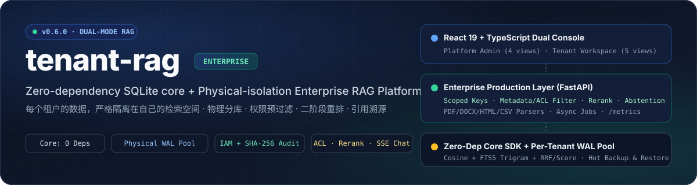
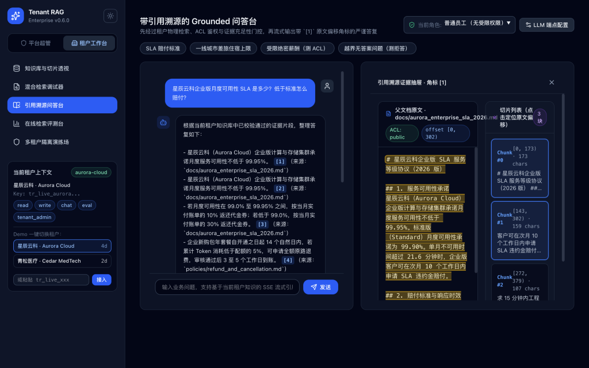
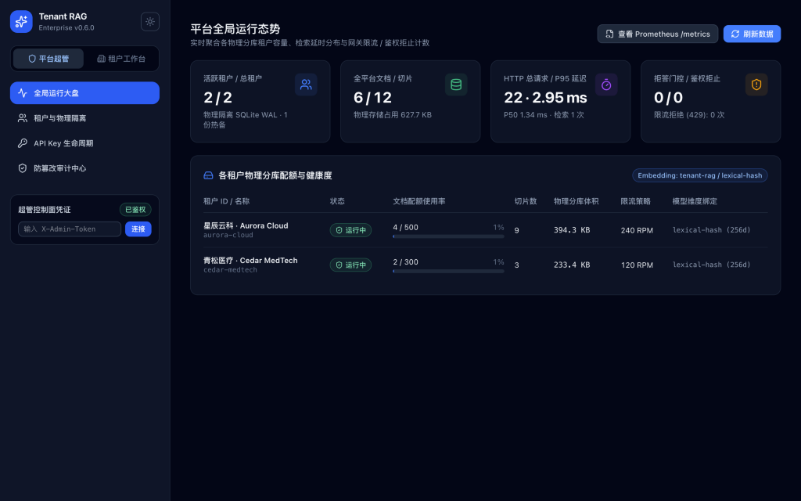
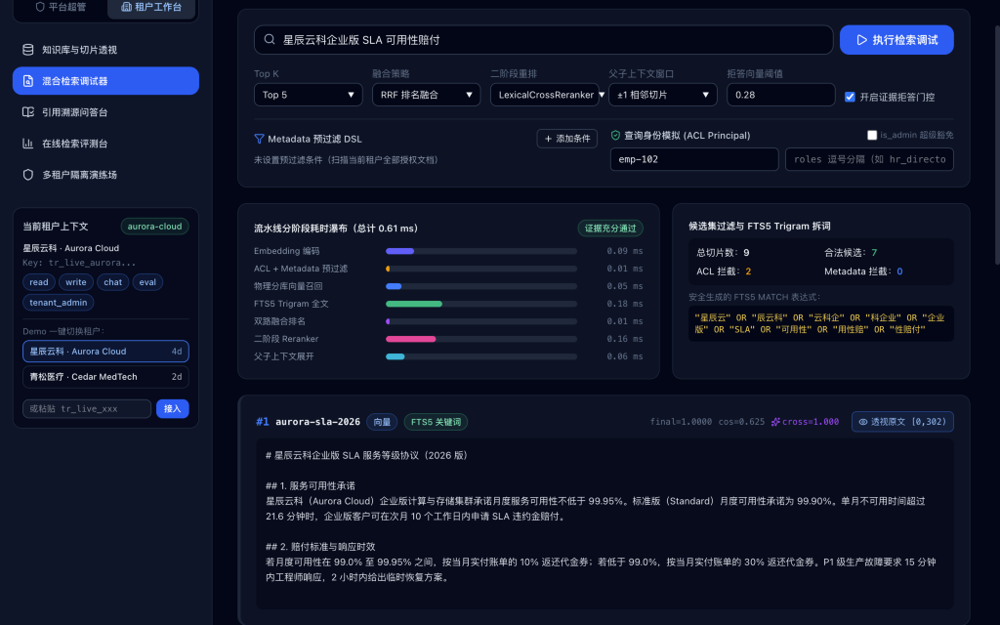
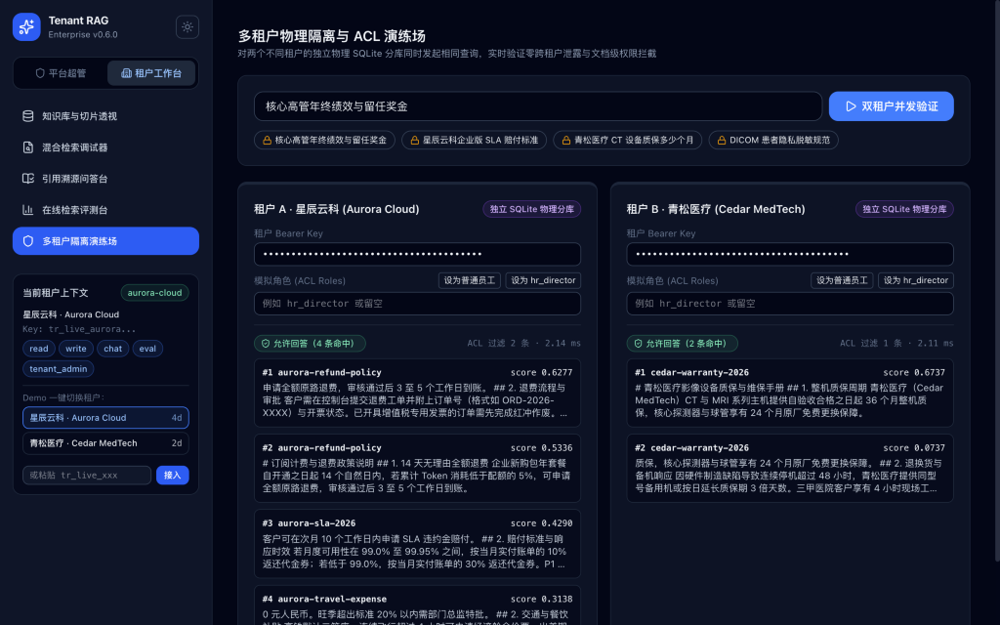
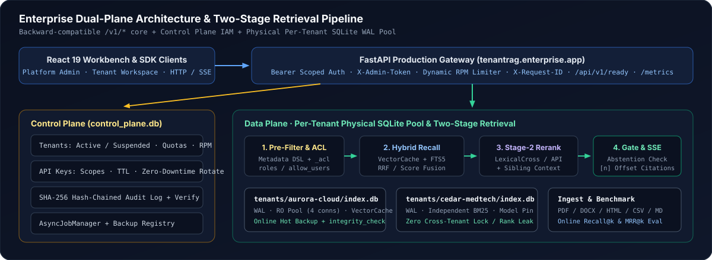

<p align="center">
  
</p>

<p align="center">
  <a href="https://github.com/tsumon/tenant-rag/actions/workflows/ci.yml"></a>
  <a href="https://github.com/tsumon/tenant-rag/releases/tag/v0.6.0"></a>
  
  
  
  
  <a href="LICENSE"></a>
</p>

<p align="center">
  <strong>每个租户的数据，严格隔离在自己的检索空间——从零依赖单文件 SQLite 内核到物理分库的企业生产级 RAG 平台。</strong>
</p>

<p align="center">
  <a href="README.md">English</a> ·
  <a href="https://github.com/tsumon/tenant-rag/releases/tag/v0.6.0">GitHub Releases (v0.6.0)</a> ·
  <a href="#30-秒启动企业工作台">企业版快速上手</a> ·
  <a href="#控制台界面预览">控制台预览</a> ·
  <a href="#架构与两阶段检索流水线">架构设计</a> ·
  <a href="#http-接口总览">接口文档</a> ·
  <a href="docs/ENTERPRISE_ARCHITECTURE.zh-CN.md">企业架构详情</a> ·
  <a href="docs/FUSION.md">融合评测研究</a> ·
  <a href="docs/RELEASING.md">发布清单</a>
</p>

---

## 双模架构定位：轻量内核 + 企业级生产层

`tenant-rag` 在演进到 **v0.6.0** 时严格保持**双模边界**：嵌入式应用依然可以零第三方依赖直接集成核心库，同时为真实企业生产提供物理隔离、多租户 IAM、权限预过滤、重排拒答与可视化工作台：

| 维度 | 零依赖核心模式（`pip install .`） | 企业真实生产模式（`pip install ".[enterprise]"`） |
|---|---|---|
| **运行时依赖** | **0 第三方依赖**（Python 3.10+ 标准库 + SQLite FTS5） | FastAPI、Uvicorn、Pydantic、`python-multipart`、`pypdf` |
| **租户隔离级别** | 单 SQLite 文件内按 `tenant_id` 强制逻辑过滤 | **物理分库连接池**（`tenants/<tid>/index.db` WAL）+ 并发只读池 + `VectorCache` |
| **IAM 与密钥管理** | 静态单 Key SHA-256 映射 | 独立控制面数据库、Scoped Key（`read`/`write`/`chat`/`eval`/`tenant_admin`）、TTL 过期、**零停机轮换**、租户启停熔断 |
| **检索与重排管线** | 余弦向量 + FTS5 trigram + RRF / 可选 Score 融合 | **召回前 Metadata DSL + `_acl` 角色过滤** → 双路融合 → **二阶段 Reranker** → 父子上下文展开 → **无答案拒答门控** |
| **文档解析管线** | 同步 `index()` 与 `ingest()`（文本 / Markdown） | `.pdf`、`.docx`、`.html`、`.csv`/`.tsv`、`.json`/`.jsonl`、`.md`、`.txt` + **异步任务队列进度追踪** |
| **问答与评测** | 返回片段与 `_chunk` 字符偏移 | **SSE 流式 Grounded 问答**（带 `[n]` 原文偏移角标，支持 OpenAI 兼容模型与离线抽取式合成）+ 在线 5 路策略评测 |
| **运维与控制台** | `tenant-rag` + 单文件本地 HTML 管理页 | `tenant-rag-enterprise` + **React 19 企业双视角工作台** + SHA-256 审计哈希链 + 在线热备恢复 + `/metrics` |

---

## 控制台界面预览

<p align="center">
  
</p>

<table width="100%">
  <tr>
    <td width="50%" valign="top">
      
      <p align="center"><sub><b>平台超管 · 全局运行大盘</b>：各物理分库容量、P95 延迟、热备计数与 Prometheus <code>/metrics</code></sub></p>
    </td>
    <td width="50%" valign="top">
      
      <p align="center"><sub><b>混合检索可视化调试器</b>：阶段耗时瀑布、ACL 预过滤统计、FTS5 拆词与 Rerank 评分</sub></p>
    </td>
  </tr>
  <tr>
    <td colspan="2" valign="top">
      
      <p align="center"><sub><b>多租户隔离与 ACL 演练场</b>：星辰云科（Aurora Cloud）与青松医疗（Cedar MedTech）物理分库并发检索实测</sub></p>
    </td>
  </tr>
</table>

<p align="center"><sub>以上截图均实拍自本地 React 19 企业控制台（使用内置合成企业语料与离线词法向量运行，无需外部付费 API Key）。</sub></p>

---

## 30 秒启动企业工作台

### 方式一：本地单命令演示启动（零 API Key 即可完整体验）

要求 **Python 3.10+** 且 SQLite 支持 **FTS5 + trigram tokenizer**（SQLite 3.34+）。

```bash
git clone https://github.com/tsumon/tenant-rag.git
cd tenant-rag
python3 -m venv .venv && . .venv/bin/activate
python -m pip install -e ".[enterprise]"

# 启动企业网关 + 内置 React 19 双视角控制台，并自动初始化双租户演示数据
tenant-rag-enterprise --data-dir ./enterprise_data --port 8080 --demo-mode --seed-demo
```

浏览器打开 **http://127.0.0.1:8080**，即可在左上角一键切换：
- **平台超管端**：`全局运行大盘`、`租户与物理隔离`（含在线热备与回滚）、`API Key 生命周期`（签发/轮换/吊销）、`防篡改审计中心`（SHA-256 哈希链校验）。
- **租户工作台**：`知识库与切片透视`、`混合检索调试器`、`引用溯源问答台`、`在线检索评测台`、`多租户隔离演练场`。

验证服务就绪与 Prometheus 指标：

```bash
curl -sS http://127.0.0.1:8080/api/v1/ready
curl -sS http://127.0.0.1:8080/metrics | head -n 15
```

### 方式二：Docker Compose 生产编排

```bash
cp .env.example .env
# 在 .env 中填入强随机 TENANT_RAG_ADMIN_TOKEN（及可选 EMBED_* / LLM_* 端点）
docker compose up -d --build
```

生产模式默认关闭 `--demo-mode`，未显式配置 `TENANT_RAG_ADMIN_TOKEN` 时所有 `/api/v1/admin/*` 接口默认拒绝访问（fail-closed）。

---

## 五分钟体验零依赖核心 SDK

仅需轻量化嵌入式检索组件时，无需安装任何第三方依赖：

```bash
python -m pip install .
python -c "import sqlite3; sqlite3.connect(':memory:').execute(\"CREATE VIRTUAL TABLE probe USING fts5(text, tokenize='trigram')\")"
```

```python
from tenantrag import TenantRAG
from tenantrag.embed import FakeEmbedder

with TenantRAG("example.db", embedder=FakeEmbedder()) as rag:
    rag.register("demo-user", "example-only-key-change-me", quota_docs=5000)
    rag.ingest(
        "example-only-key-change-me",
        "# 退费说明\n开通 14 个自然日内且 Token 消耗低于 5% 可申请全额退费。",
        doc_id="refund-policy",
        source="refunds.md",
        format="markdown",
        max_chars=400,
        overlap=50,
    )
    hits = rag.search("example-only-key-change-me", "14天全额退费", k=5)
    print(hits[0]["doc_id"], hits[0]["metadata"]["_chunk"])
```

原有轻量 HTTP 服务（`tenant-rag --db example.db --port 8000`）与本地管理页（`tenant-rag-admin --api http://127.0.0.1:8000 --port 8002`）继续保持 100% 兼容。真实本地模型复现案例见 [完整中英双租户教程](examples/local_trial/README.zh-CN.md)。

---

## 架构与两阶段检索流水线

<p align="center">
  
</p>

1. **控制面 IAM（`control_plane.db`）**：管理租户生命周期（`active` / `suspended` 瞬时熔断）、动态文档/切片/RPM 配额、SHA-256 存储的 Scoped API Key（`tr_live_*`）、异步任务状态、备份清单，以及支持全链防篡改验证的 **SHA-256 哈希链审计日志**（`/api/v1/admin/audit/verify`）。
2. **物理分库存储池（`TenantPool`）**：每个租户独享 `tenants/<tenant_id>/index.db`（严格校验 `^[A-Za-z0-9._-]{1,64}$` 防止路径穿越），消除跨租户 FTS5 BM25 词频统计干扰与写锁阻塞。查询走 `mode=ro` 并发只读连接池 + 写入版本号驱动的归一化 `VectorCache`。
3. **召回前 Metadata DSL 与 `_acl` 权限过滤**：在进入向量与 FTS5 Top-K 截断**之前**先筛选合法候选集，避免高密级或无关文档挤占名额：
   ```json
   {
     "query": "企业版 SLA 可用性赔付",
     "k": 5,
     "fusion": "rrf",
     "reranker": "lexical",
     "context_window": 1,
     "check_abstention": true,
     "min_vector_score": 0.28,
     "filters": { "dept": { "$eq": "cloud" }, "sla_pct": { "$gte": 99.9 } },
     "principal": { "user_id": "alice", "roles": ["hr_director"] }
   }
   ```
4. **二阶段重排、父子上下文展开与拒答门控**：`LexicalCrossReranker` 补充 CJK 二元字/单字覆盖度与数字编码精确匹配（弥补 trigram 对 2 字以下中文短词的召回盲区）；`APIReranker` 对接标准 `/rerank` 服务。`context_window` 自动还原相邻父文档片段，`check_abstention` 在缺失足够语义/关键词证据时安全拒答。
5. **多格式解析与 Grounded SSE 问答**：支持 `.md`、`.txt`、`.html`、`.csv`/`.tsv`、`.json`/`.jsonl`、标准库 `.docx` XML 与 `.pdf`（`pypdf`）入库；`/api/v1/chat/stream` 输出带 `[n]` 精确字符偏移角标的流式答复。

---

## HTTP 接口总览

### 经典兼容接口（`/v1/*`，租户 Bearer Key）

| 方法 | 路径 | 说明 |
|---|---|---|
| `POST` | `/v1/index` | 单文档直接索引（不自动切块） |
| `POST` | `/v1/ingest` | 显式文本/Markdown 切块入库，保留 `_chunk` 偏移 |
| `POST` | `/v1/ingest/batch` | 原子批量增量入库（复用未变化文本向量） |
| `POST` | `/v1/search` | 混合检索（默认 RRF，可选 `fusion="score"`） |
| `GET` | `/v1/docs` | 分页获取父文档/单文档列表 |
| `DELETE` | `/v1/docs/<id>` | 原子删除父文档及其全部子切片 |
| `GET` | `/v1/usage` | 文档用量、配额、今日请求计数与限流配置 |
| `GET` | `/v1/health` | 进程存活探针 |

### 企业租户接口（`/api/v1/*`，Scoped Bearer Key）

| 方法 | 路径 | 所需 Scope | 说明 |
|---|---|---|---|
| `GET` | `/api/v1/whoami` | 任意有效 Key | 当前租户身份、权限、物理库统计与 LLM 配置状态 |
| `GET` / `DELETE` | `/api/v1/docs` · `/api/v1/docs/{doc_id}` | `read` / `write` | 分页浏览、查看父文档全文与有序切片偏移、删除 |
| `POST` | `/api/v1/ingest` | `write` | 切块入库并绑定 Metadata 与 `_acl` 权限 |
| `POST` | `/api/v1/ingest/files` | `write` | 多格式文件上传解析（支持同步或异步任务队列） |
| `GET` | `/api/v1/jobs` · `/api/v1/jobs/{job_id}` | `read` | 查询异步解析入库任务状态与进度 |
| `POST` | `/api/v1/search` | `read` | ACL/Metadata 预过滤、二阶段重排、上下文展开与耗时瀑布 |
| `POST` | `/api/v1/chat` · `/api/v1/chat/stream` | `chat` | 同步或 SSE 流式 Grounded 问答（含 `[n]` 引用与拒答门控） |
| `POST` | `/api/v1/eval/run` | `eval` | 运行 5 种检索策略的在线对比评测（`golden` / `tenant_live`） |
| `GET` | `/api/v1/ready` · `/metrics` | 公开 | 控制面就绪检查与 Prometheus 监控指标暴露 |

### 平台超管接口（`/api/v1/admin/*`，`X-Admin-Token`）

| 方法 | 路径 | 说明 |
|---|---|---|
| `GET` | `/api/v1/admin/overview` | 全平台租户配额使用率、物理库大小、P50/P95 延迟 |
| `GET` / `POST` / `PATCH` / `DELETE` | `/api/v1/admin/tenants` · `/{tid}` | 创建租户、启停熔断、动态调整配额/RPM、物理擦除 |
| `GET` / `POST` | `/api/v1/admin/keys` · `/tenants/{tid}/keys` | 查看或按 Scope 签发 `tr_live_*` 密钥（支持过期 TTL） |
| `POST` | `/api/v1/admin/keys/{kid}/rotate` · `/revoke` | 宽限期零停机平滑轮换或立即吊销 |
| `GET` / `POST` | `/api/v1/admin/backups` · `/tenants/{tid}/backups/{bid}/restore` | `sqlite3.backup()` 在线热备、SHA-256 + 完整性校验与回滚 |
| `GET` | `/api/v1/admin/audit` · `/audit/verify` | 查询审计日志与一键核验 SHA-256 审计哈希链 |

---

## 接入真实模型与测试评测

### 环境变量配置真实 Embedding / LLM / Rerank

```bash
export TENANT_RAG_ADMIN_TOKEN="$(python -c 'import secrets; print(secrets.token_urlsafe(32))')"
export EMBED_BASE_URL="https://api.openai.com/v1"
export EMBED_API_KEY="your-embed-key"
export EMBED_MODEL="text-embedding-3-small"
export EMBED_REVISION="2024-02"

# 可选：外接问答大模型与重排接口（不配则使用内置离线引用合成与 LexicalCrossReranker）
export LLM_BASE_URL="https://api.openai.com/v1"
export LLM_API_KEY="your-llm-key"
export LLM_MODEL="gpt-4o-mini"

tenant-rag-enterprise --host 127.0.0.1 --port 8080 --data-dir ./enterprise_data
```

数据库依然严格绑定模型身份（`provider`、`model`、`revision`、`dimension`），切换模型需显式全库原子重建，防止同维度向量混用。详见 [v0.4 升级指南](docs/V0.4.md) 与 [v0.5 说明](docs/V0.5.md)。

### 离线回归门禁与证据校验

```bash
# 全量单元与企业接口集成测试（245 项用例）
python3 -m unittest discover -v

# 检索管线门禁评测、订阅演示与发布证据校验
python3 eval/run_eval.py --k 3 --min-recall 0.8 --min-mrr 0.7
python3 demo/run_demo.py
python3 scripts/verify_evidence.py
```

---

## 运行边界说明

- **单机物理分库池，非多节点分布式集群**：每个租户拥有独立的本地 SQLite WAL 分库与只读并发池；如需跨多台宿主机水平扩容，需将存储与限流状态迁移至共享分布式数据库/缓存。
- **默认离线词法向量仅用于管线验证与零费用演示**：未配置 `EMBED_BASE_URL` 时，`FakeEmbedder` 生成确定性词法哈希向量；正式上线请接入真实语义向量模型，并基于代表性业务数据校准 `min_vector_score` 拒答阈值。
- **公网暴露前安全加固**：请在反向代理层启用 TLS，配置强随机 `TENANT_RAG_ADMIN_TOKEN`（生产环境切勿开启 `--demo-mode`），做好 `data-dir` 与热备目录的磁盘权限隔离并定期演练恢复流程。

---

## License

[MIT](LICENSE)。
